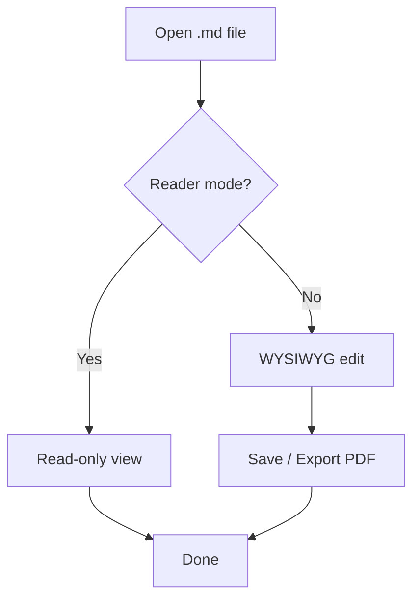
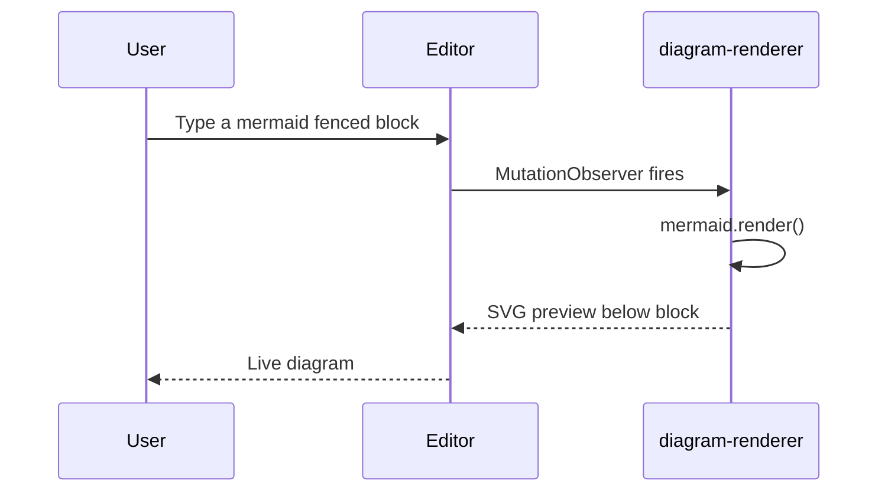
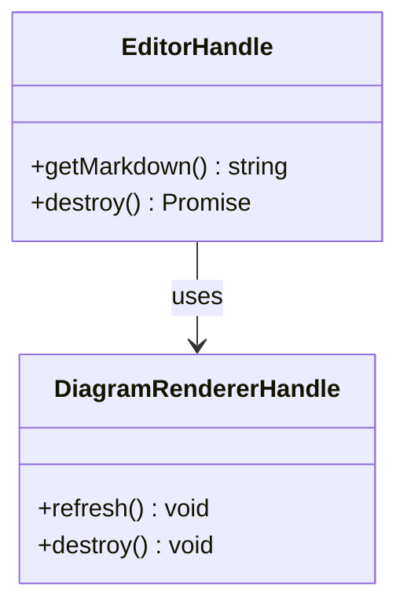
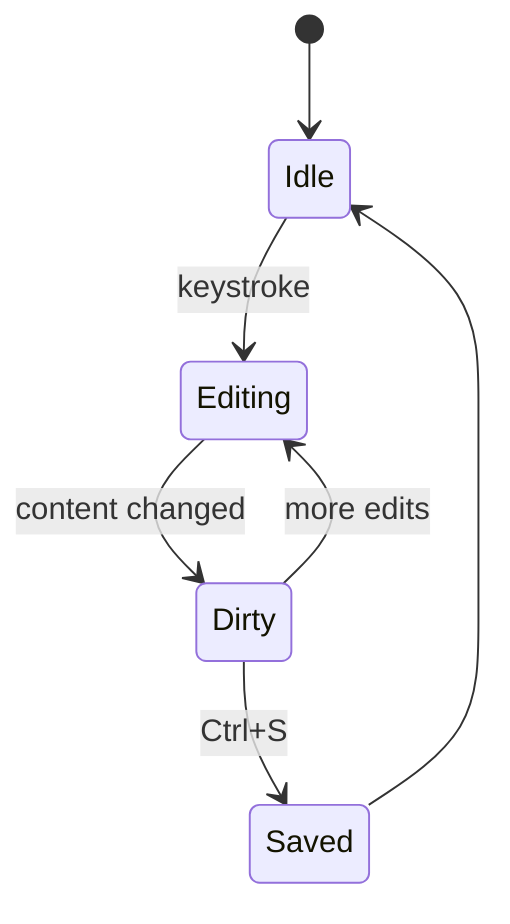
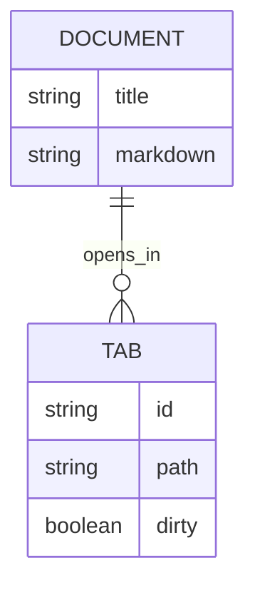
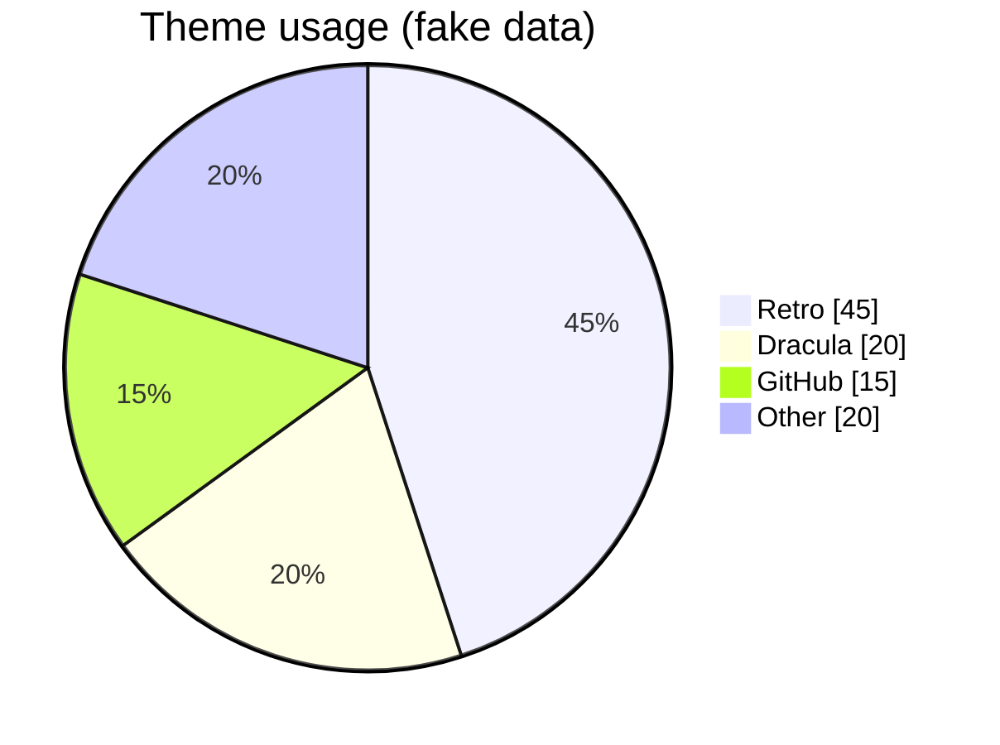
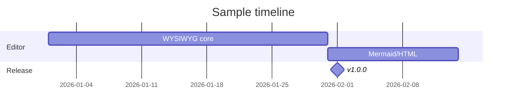

# Markdown Formatting Test

Documento de teste para **Eddie** — headings, GFM, código, Mermaid e HTML.

---

## Headings

# Heading 1
## Heading 2
### Heading 3
#### Heading 4
##### Heading 5
###### Heading 6

---

## Inline formatting

Parágrafo normal com **negrito**, *itálico*, ***negrito + itálico***, ~~riscado~~ e `código inline`.

Link: [Eddie no GitHub](https://github.com/Awi-24/eddie)

Imagem:


---

## Lists

### Unordered

- Item A
- Item B
  - Subitem B.1
  - Subitem B.2
    - Subitem B.2.a
- Item C

### Ordered

1. Primeiro
2. Segundo
   1. Segundo.a
   2. Segundo.b
3. Terceiro

### Task list (GFM)

- [x] Tabelas
- [x] Code blocks
- [x] Mermaid preview
- [ ] Item pendente
- [ ] Outro pendente

---

## Blockquotes

> Citação simples.
>
> > Citação aninhada.
>
> Com **formatação** e `código`.

---

## Table

| Alinhado à esquerda | Centro | Direita |
| :------------------ | :----: | ------: |
| célula A            |   B    |       C |
| `inline code`       | **bold** | *italic* |
| linha longa de texto para testar quebra de coluna | ok | 42 |

---

## Code blocks (syntax highlight)

### Rust

```rust
fn greet(name: &str) -> String {
    format!("Hello, {name}!")
}

fn main() {
    println!("{}", greet("Eddie"));
}
```

### TypeScript

```typescript
type Tab = { id: string; title: string; dirty: boolean };

function markDirty(tabs: Tab[], id: string): Tab[] {
  return tabs.map((t) => (t.id === id ? { ...t, dirty: true } : t));
}
```

### Python

```python
def fib(n: int) -> list[int]:
    a, b = 0, 1
    out = []
    for _ in range(n):
        out.append(a)
        a, b = b, a + b
    return out
```

### JSON

```json
{
  "app": "Eddie",
  "version": "1.0.0",
  "features": ["gfm", "mermaid", "html-preview"]
}
```

### Bash

```bash
npm install
npm run tauri dev
```

### Plain text

```text
Sem linguagem definida — bloco de texto simples.
```

---

## Mermaid diagrams

### Flowchart



### Sequence diagram



### Class diagram



### State diagram



### ER diagram



### Pie chart



### Gantt



---

## HTML blocks (live preview)

O Eddie renderiza blocos `html` com sanitização (sem `<script>`, sem `onclick`, etc.).

### Card layout

```html
<div style="border: 2px solid #333; padding: 1rem; border-radius: 8px; max-width: 420px; font-family: system-ui, sans-serif;">
  <h3 style="margin: 0 0 0.5rem; color: #1a1a1a;">HTML preview card</h3>
  <p style="margin: 0; color: #444;">
  This block is rendered below the fenced <code>html</code> code editor.
  </p>
  <p style="margin: 0.75rem 0 0; font-size: 0.9em; color: #666;">
  <strong>Tip:</strong> edit the HTML above and the preview updates live.
  </p>
</div>
```

### Styled table

```html
<table style="border-collapse: collapse; width: 100%; max-width: 480px;">
  <thead>
    <tr style="background: #f0f0f0;">
      <th style="border: 1px solid #ccc; padding: 8px; text-align: left;">Feature</th>
      <th style="border: 1px solid #ccc; padding: 8px; text-align: left;">Status</th>
    </tr>
  </thead>
  <tbody>
    <tr>
      <td style="border: 1px solid #ccc; padding: 8px;">GFM tables</td>
      <td style="border: 1px solid #ccc; padding: 8px; color: green;">OK</td>
    </tr>
    <tr>
      <td style="border: 1px solid #ccc; padding: 8px;">Mermaid</td>
      <td style="border: 1px solid #ccc; padding: 8px; color: green;">OK</td>
    </tr>
    <tr>
      <td style="border: 1px solid #ccc; padding: 8px;">HTML preview</td>
      <td style="border: 1px solid #ccc; padding: 8px; color: green;">OK</td>
    </tr>
  </tbody>
</table>
```

### Badge row

```html
<div style="display: flex; gap: 8px; flex-wrap: wrap;">
  <span style="background: #222; color: #fff; padding: 4px 10px; border-radius: 4px; font-size: 12px;">retro</span>
  <span style="background: #e8e8e8; color: #222; padding: 4px 10px; border-radius: 4px; font-size: 12px;">gfm</span>
  <span style="background: #4a9eff; color: #fff; padding: 4px 10px; border-radius: 4px; font-size: 12px;">mermaid</span>
</div>
```

### Sanitization test (should NOT execute)

```html
<p>Safe paragraph. The script below should be stripped:</p>
<script>alert('xss')</script>
<button onclick="alert('click')">No handler</button>
<a href="javascript:alert(1)">No javascript URL</a>
```

---

## Embedded HTML (inline e bloco)

Atalho <kbd>Ctrl</kbd>+<kbd>S</kbd>, fórmula H<sub>2</sub>O, x<sup>2</sup>, <mark>destaque</mark> e quebra<br>de linha.

<!-- comentário: some no modo leitura -->

<div align="center">

**Bloco centralizado** com Markdown dentro.

</div>

<details>
<summary>Clique para expandir</summary>

Conteúdo escondido com *Markdown*.

</details>

<p style="color: #888">Parágrafo HTML com estilo inline.</p>

<style>body { background: red !important; }</style>

A tag `<style>` acima não deve afetar o app.

---

## GitHub alerts

> [!NOTE]
> Informação útil.

> [!TIP]
> Dica opcional.

> [!IMPORTANT]
> Informação essencial.

> [!WARNING]
> Atenção necessária.

> [!CAUTION]
> Consequências negativas.

---

## Footnotes e LaTeX

Texto com nota de rodapé[^1] e fórmula inline $E = mc^2$.

$$
\int_0^1 x^2 \, dx = \frac{1}{3}
$$

[^1]: A nota de rodapé.

---

## Mixed content

Parágrafo final com referência a um diagrama acima, uma [tabela](#table) e blocos de código.

> **Checklist rápido**
> - [ ] Headings H1–H6
> - [ ] Listas e tasks
> - [ ] Tabela GFM
> - [ ] Syntax highlight
> - [ ] Mermaid SVG
> - [ ] HTML preview

---

*Fim do teste — Eddie formatting suite.*
